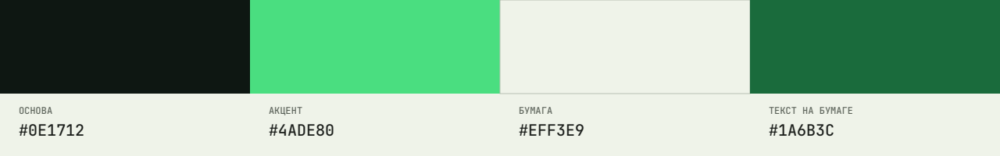
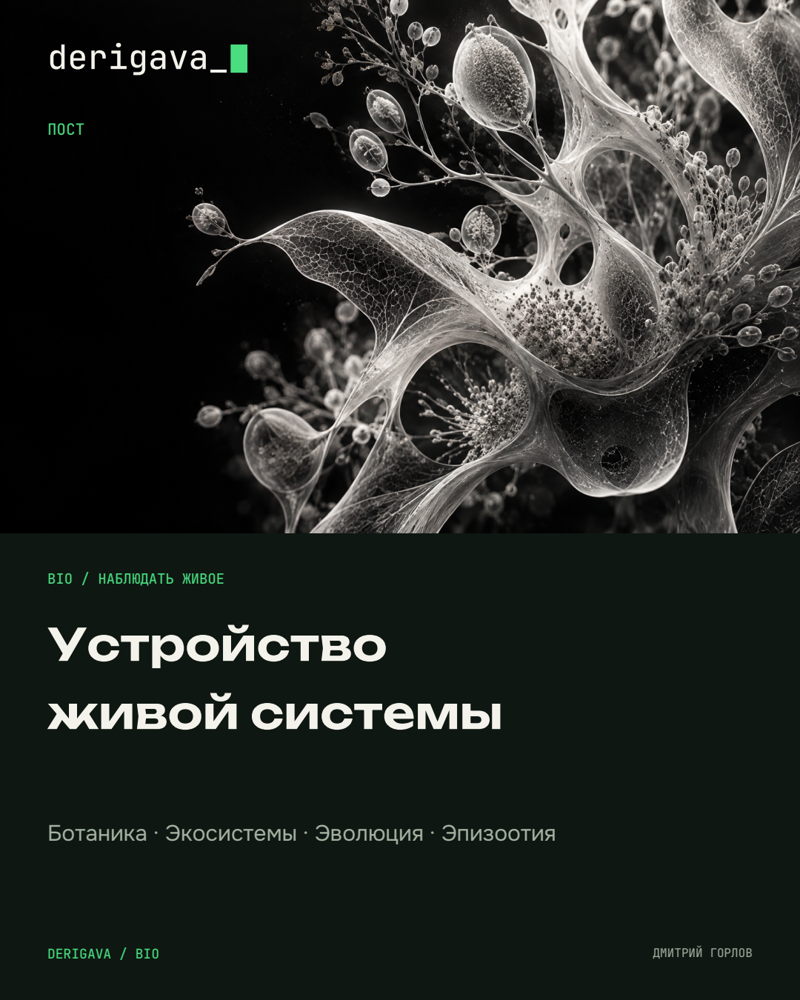
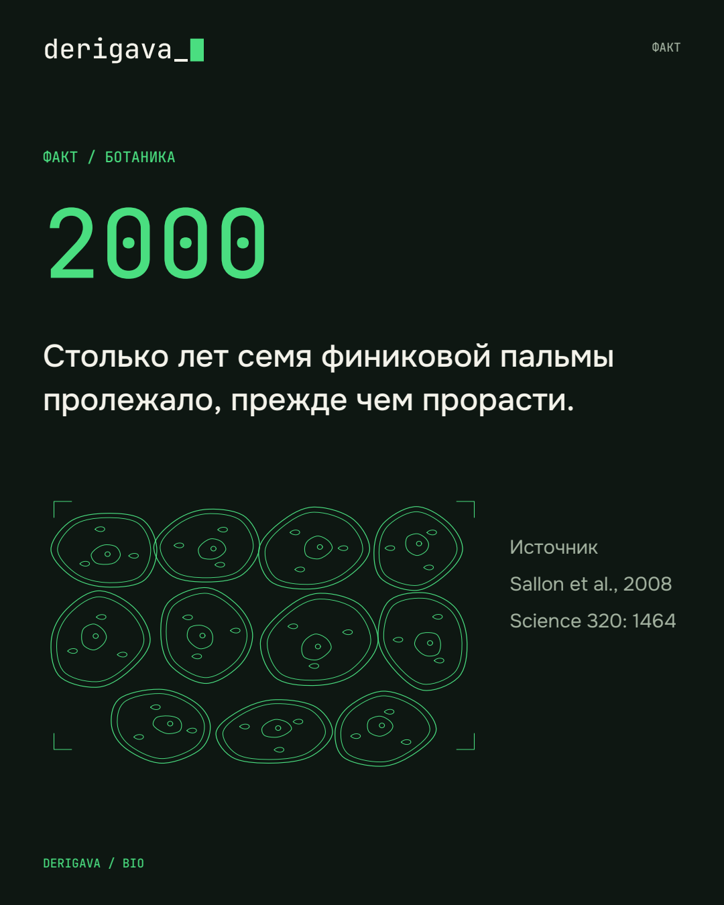
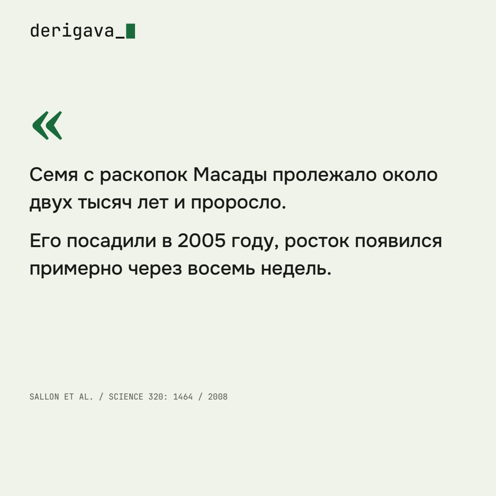

# Биология

Наблюдать живое. Ботаника · Экосистемы · Эволюция · Эпизоотия.

Точная формулировка, любопытство, границы вывода. Источник не прячется за красивой картинкой. Научная графика отделена от декоративной. У факта есть источник, у исследования метод и ограничения.

## В папке

- [templates](templates): макеты в SVG и PNG
- [icons](icons): 24 иконки, цвет задаётся через currentColor
- [graphics](graphics): 3 графических модуля
- [signatures](signatures): подписи и аватар
- [BIO — визуальный гид.pdf](BIO%20%E2%80%94%20%D0%B2%D0%B8%D0%B7%D1%83%D0%B0%D0%BB%D1%8C%D0%BD%D1%8B%D0%B9%20%D0%B3%D0%B8%D0%B4.pdf)

SVG редактируются, если установить шрифты из [00 Основа/assets/fonts](../00%20Основа/assets/fonts).

## Научные жанры

- `article`: своя статья
- `journal`: пустой научный манускрипт
- `journal-review`: разбор чужой публикации

В карточке факта не больше трёх строк главного текста. Источник набран 29 px, чтобы читался после уменьшения. Пустые версии макетов лежат в [templates/blank](templates/blank).
