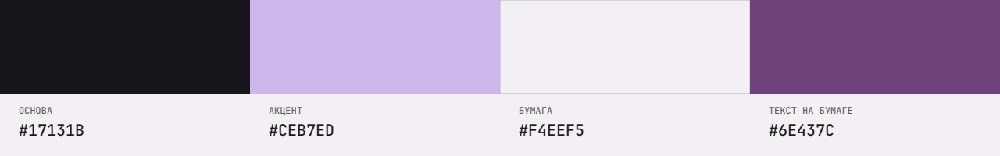
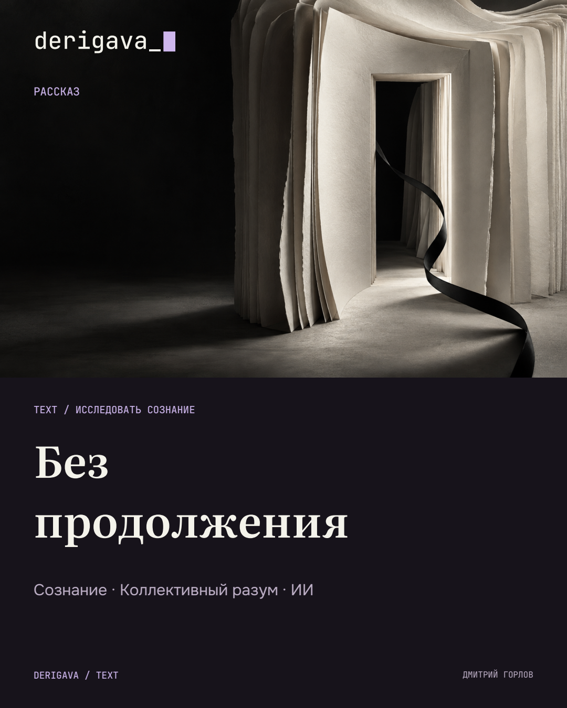
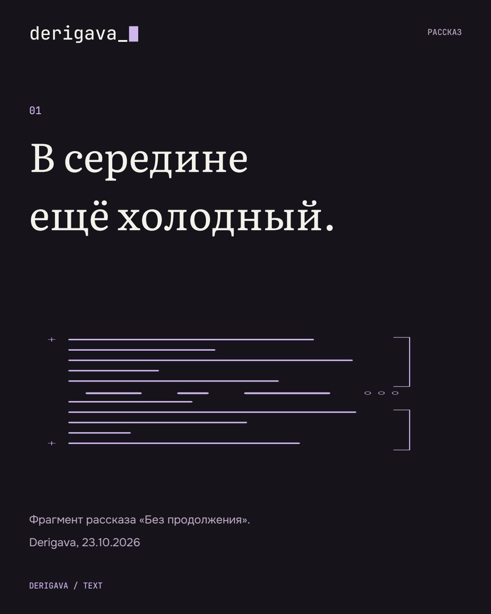
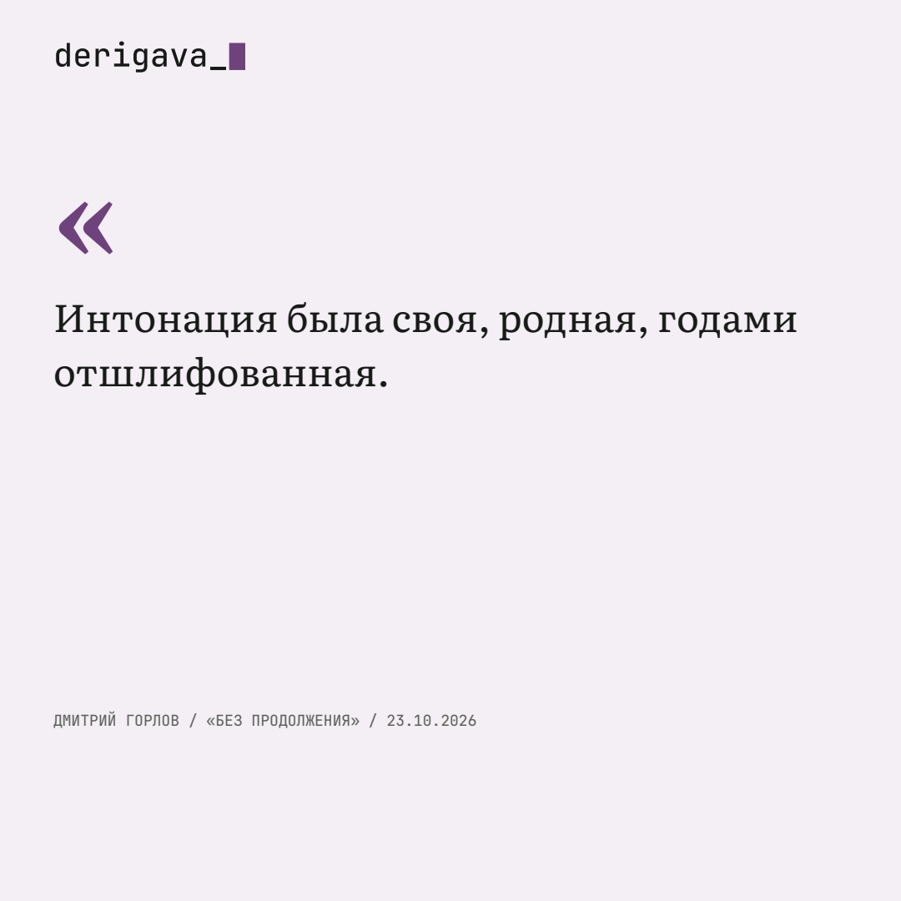

# Писательство

Исследовать сознание. Сознание · Коллективный разум · ИИ.

Бытовая деталь, внутренний ритм, пауза. История может не давать удобного вывода. Литературе не нужен обязательный CTA. Ритм абзацев и авторская пунктуация сохраняются.

## В папке

- [templates](templates): макеты в SVG и PNG
- [icons](icons): 24 иконки, цвет задаётся через currentColor
- [graphics](graphics): 3 графических модуля
- [signatures](signatures): подписи и аватар
- [TEXT — визуальный гид.pdf](TEXT%20%E2%80%94%20%D0%B2%D0%B8%D0%B7%D1%83%D0%B0%D0%BB%D1%8C%D0%BD%D1%8B%D0%B9%20%D0%B3%D0%B8%D0%B4.pdf)

SVG редактируются, если установить шрифты из [00 Основа/assets/fonts](../00%20Основа/assets/fonts).
