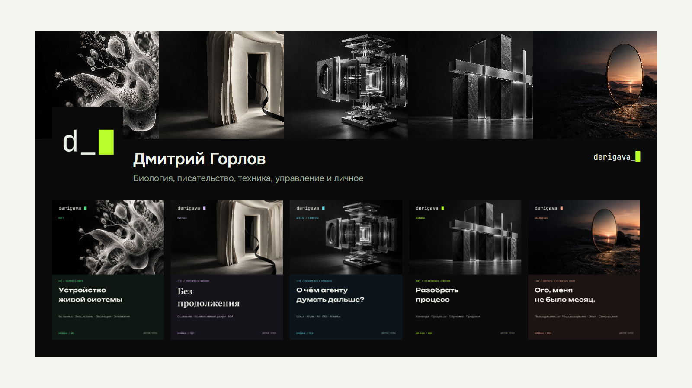
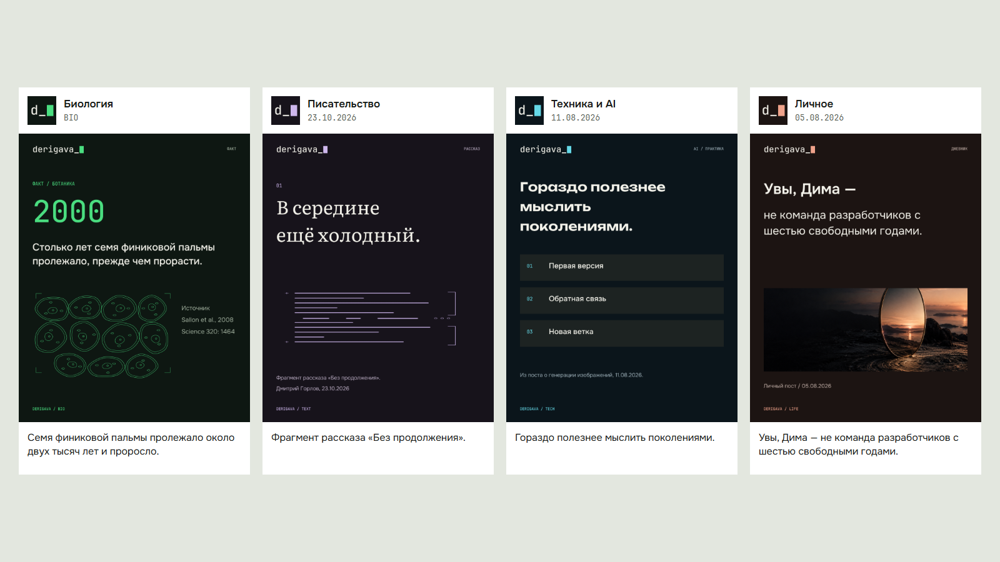
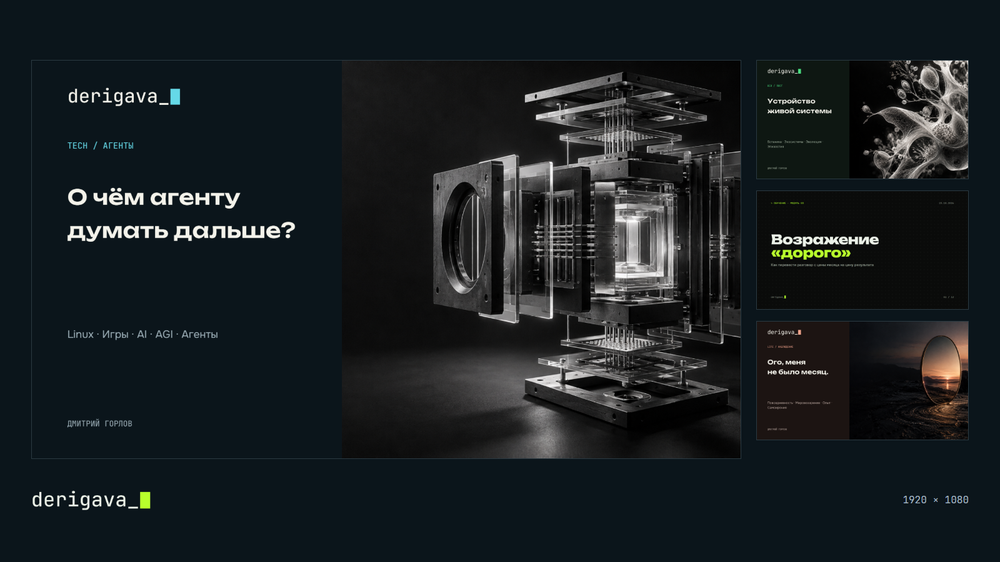
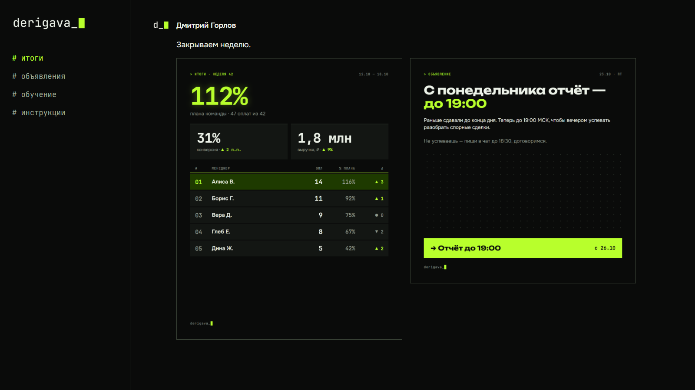
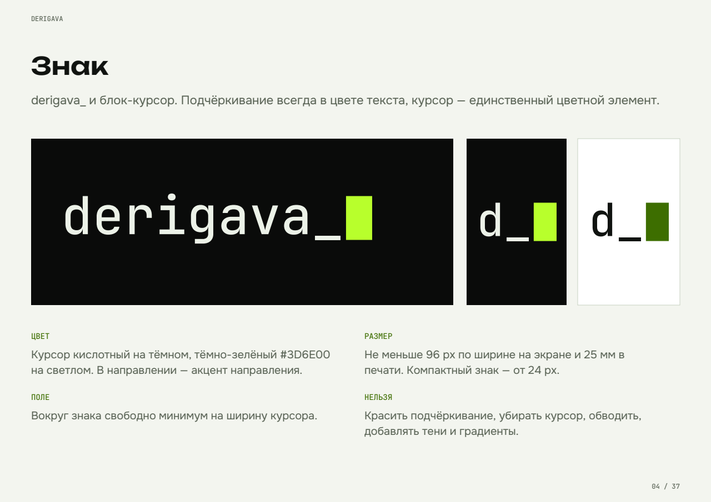
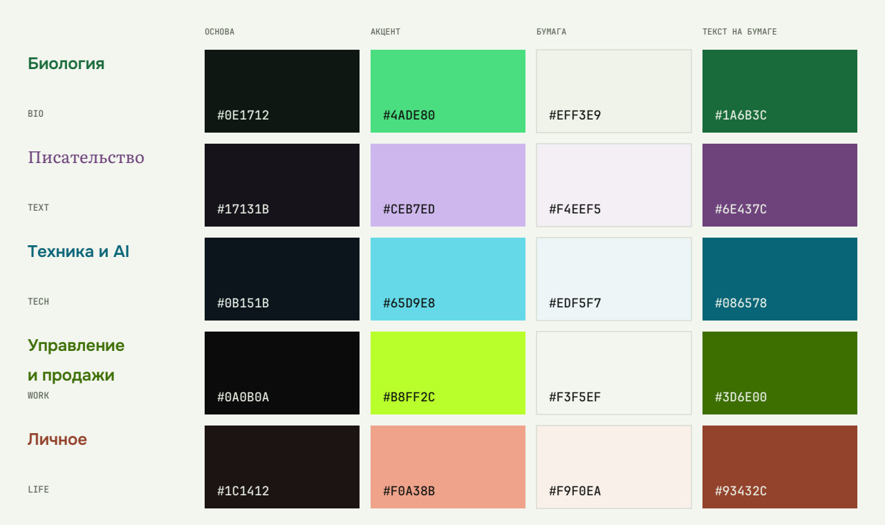
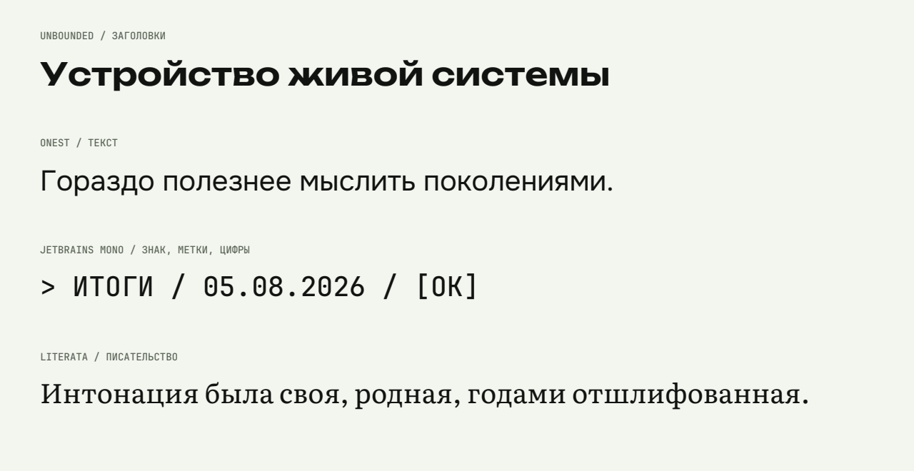

  <picture>
    <source media="(prefers-color-scheme: dark)" srcset="00%20Основа/logos/wordmark-dark-color.png">
    
  </picture>

  Знак и визуальная система Дмитрия Горлова. 
  Я пишу про биологию, технику, управление, продажи и про себя, а ещё прозу. 
  У каждой темы свой цвет, знак один.

  <a href="https://derigava.github.io/derigava-brand/">Галерея</a> ·
  <a href="Derigava%20—%20визуальная%20система.pdf">Книга PDF</a> ·
  <a href="https://github.com/Derigava/derigava-brand/releases/latest/download/derigava-logos.zip">Логотипы</a> ·
  <a href="04%20Управление%20и%20продажи/Командный%20кит">Командный кит</a>

## Направления

<table>
  <tr>
    <td width="20%"></td>
    <td width="20%"></td>
    <td width="20%"></td>
    <td width="20%"></td>
    <td width="20%"></td>
  </tr>
  <tr>
    <td><a href="01%20Биология"><b>Биология</b></a> Ботаника, экосистемы, эволюция, эпизоотия</td>
    <td><a href="02%20Писательство"><b>Писательство</b></a> Сознание, коллективный разум, ИИ</td>
    <td><a href="03%20Техника%20и%20AI"><b>Техника и AI</b></a> Linux, игры, AI, AGI, агенты</td>
    <td><a href="04%20Управление%20и%20продажи"><b>Управление и продажи</b></a> Команда, процессы, обучение, продажи</td>
    <td><a href="05%20Личное"><b>Личное</b></a> Повседневность, мировоззрение, опыт, самоирония</td>
  </tr>
</table>

В каждой папке 24 иконки, 3 графических модуля, иллюстрация, макеты в SVG и PNG, подписи с аватаром и PDF-гид.

## В работе

 
 

## Знак

Все версии лежат в [00 Основа/logos](00%20Основа/logos): полный и компактный знак, аватары, связки с именем, для тёмного и светлого фона.

## Цвет

Те же значения для кода: [palettes.json](00%20Основа/source/palettes.json).

## Шрифты

Файлы и лицензии: [00 Основа/assets/fonts](00%20Основа/assets/fonts).

---

Иллюстрации и референс знака сгенерированы в ChatGPT по моему заданию ([промпты](00%20Основа/Промпты%20иллюстраций.md)), вёрстка и скрипты сделаны с Claude. Цвета, шрифты, размеры и акценты мои. [Как пересобрать](00%20Основа/source/README.md).

© 2026 Дмитрий Горлов (Dmitriy Gorlov). Все права защищены, [условия](LICENSE.md).
